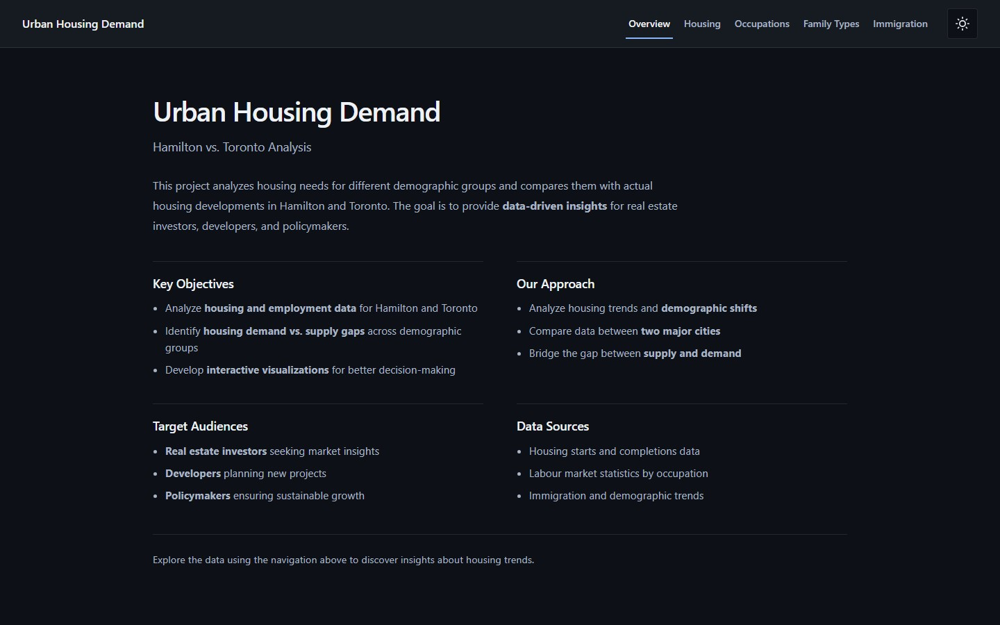
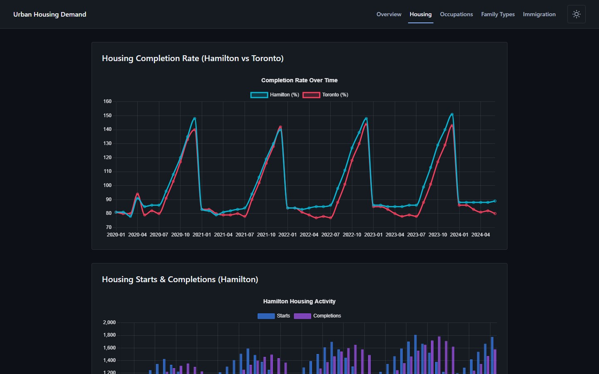
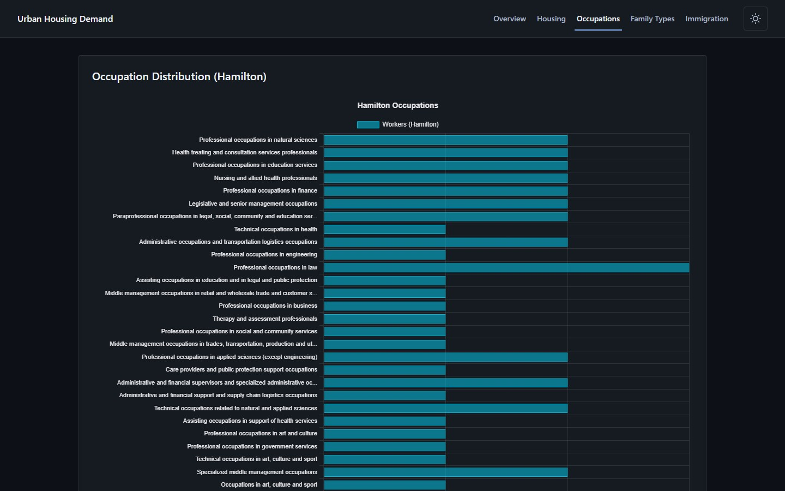
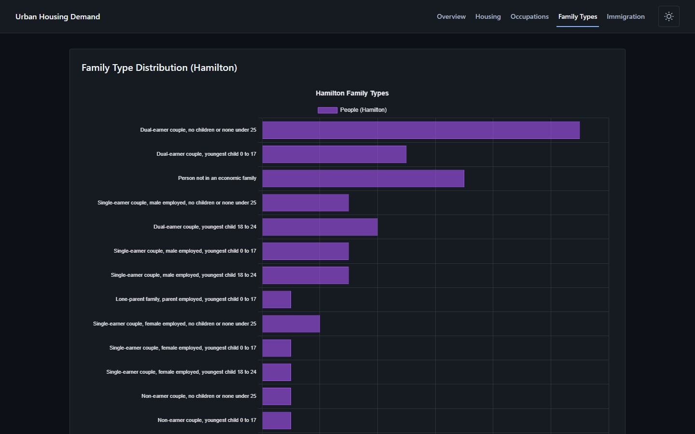
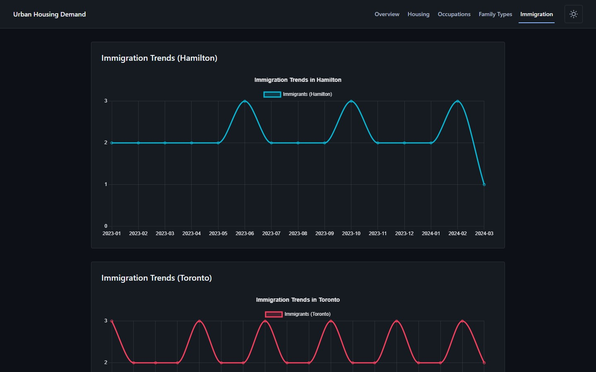

# Urban Housing Demand

[](https://github.com/haseebn19/urban-housing-demand/actions/workflows/ci.yml)

A full-stack web application for visualizing housing and labour market data for Toronto and Hamilton, Ontario.

## Screenshots











## Features

- **Housing Data Visualization**: Track housing starts and completions over time
- **Completion Ratios**: Compare completion rates between Toronto and Hamilton
- **Labour Market Analysis**: View occupation and family type distributions
- **Immigration Trends**: Monitor immigration patterns in both cities
- **Dark/Light Theme**: Follows the system setting until you switch it in the navigation bar

## Prerequisites

- [Docker Desktop](https://www.docker.com/products/docker-desktop/)

For frontend development outside Docker, use Node.js 20.19+ or 22.12+. For backend development outside Docker, use Java 21.

## Installation

```bash
git clone https://github.com/haseebn19/urban-housing-demand.git
cd urban-housing-demand
```

## Usage

Copy `.env.example` to `.env` and set `DB_PASSWORD` in it. There is no default, for security. Then start the app:

```bash
docker compose up -d
```

Open http://localhost:3000

## Development

### Testing

```bash
# Run all tests
docker compose -f compose.test.yaml up --build
```

### Linting

```bash
# Frontend (ESLint, Prettier, and TypeScript)
(cd frontend && npm run lint && npm run format:check && npm run type-check)

# Backend (Checkstyle, formatting, and tests; ./gradlew spotlessApply fixes formatting)
(cd backend && ./gradlew check)

# Ingestor (Ruff)
(cd ingestor && pip install -r requirements-dev.txt && ruff check . && ruff format --check .)
```

## Building

```bash
docker compose build
```

Output: Docker images for frontend, backend, database, and ingestor services.

## Documentation

Full documentation is available on the [Wiki](https://github.com/haseebn19/urban-housing-demand/wiki):

| Doc | Description |
|-----|-------------|
| [Getting Started](https://github.com/haseebn19/urban-housing-demand/wiki/Getting-Started) | Installation, env vars, basic commands |
| [Architecture](https://github.com/haseebn19/urban-housing-demand/wiki/Architecture) | System design and components |
| [API Reference](https://github.com/haseebn19/urban-housing-demand/wiki/API-Reference) | REST endpoints |
| [Database Schema](https://github.com/haseebn19/urban-housing-demand/wiki/Database-Schema) | Tables and mappings |
| [Development Guide](https://github.com/haseebn19/urban-housing-demand/wiki/Development-Guide) | Contributing, local dev, CI/CD |

## Tech Stack

| Layer | Technology |
|-------|------------|
| Frontend | React 18, TypeScript, Vite, Chart.js |
| Backend | Spring Boot 3.5, Java 21 |
| Database | MariaDB/MySQL |
| Ingestor | Python 3.12 |
| DevOps | Docker, GitHub Actions |

## Project Structure

```text
urban-housing-demand/
+-- frontend/             React dashboard
+-- backend/              Spring Boot API (package io.github.haseebn19.uhd)
+-- database/             MariaDB schema and seed data
+-- ingestor/             Python data loader
+-- swag/                 Reverse proxy settings for deployment
+-- docs/                 README screenshots
+-- .env.example          Example environment file (copy to .env)
+-- compose.yaml          Docker Compose services
+-- compose.test.yaml     Runs every test suite in Docker
+-- compose.deploy.yaml   Production setup behind the SWAG reverse proxy
```

## Credits

### Development Team
- Haseeb Niazi
- Athina Manolakou
- Ricardo Lazo
- Samantha Hilborn
- Mohammad Shoib Wahab
- Adam Fischer

### Third-Party Libraries
- [React](https://react.dev/) - Frontend framework
- [Chart.js](https://www.chartjs.org/) - Data visualization
- [Spring Boot](https://spring.io/projects/spring-boot) - Backend framework
- [MariaDB](https://mariadb.org/) - Database

## License

This project is licensed under the [MIT License](LICENSE).

---

*Originally developed for CIS\*4900 at the University of Guelph.*
